# Microplate Analyzer — User Guide

Analyze microplate photos entirely **on your phone**: the app detects the plate,
finds every well, and classifies each well as **Growth / NoGrowth / NoAgar** —
no internet connection needed, and photos never leave the device.

The app opens on three tabs:

| Tab | Purpose |
|-----|---------|
| **Projects** | Organize photos into projects and run the analysis pipeline |
| **History** | Browse every finished analysis, filter by project |
| **Trash Bin** | Restore or permanently delete removed images |

> **Tip:** the app works in any orientation, but **landscape** is recommended —
> the workspace shows the image list and stage results side by side.
> The first launch pauses ~2 seconds while the three AI models load.

---

## 1. Projects — getting started

All work happens inside a project. The **Projects** tab lists your projects with
their image counts; tap a project to open its workspace.

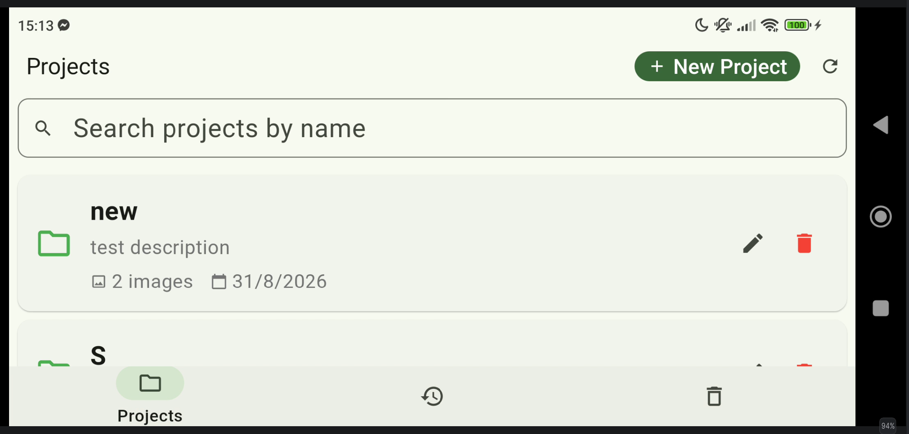

**To create a project:** tap the **＋ New Project** button (top-right, beside
Refresh), enter a name (optional description), then tap **Save**.

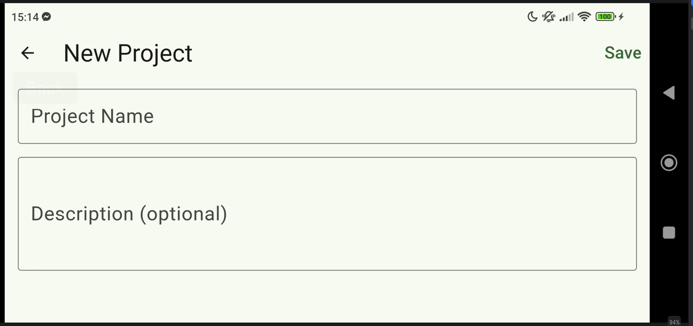

---

## 2. The workspace

Each project opens into a two-pane workspace:

- **Left — image list:** thumbnails with a checkbox, a status icon, the file
  name, and a per-image delete button (🗑).
- **Right — detail panel:** the selected photo, one card per pipeline stage,
  and the results panel.

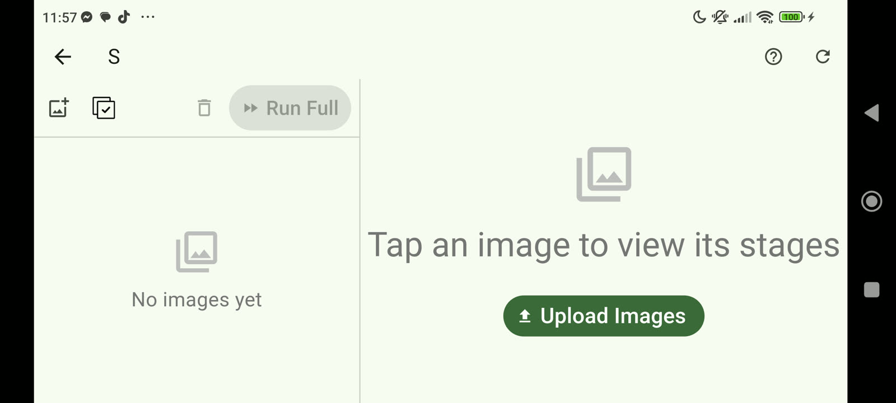

### Adding images

Tap the **add-images** button (🖼, top-left of the toolbar) and choose:

- **Choose from gallery** — pick one or many photos at once;
- **Take a photo** — opens the camera and adds the single shot you take.

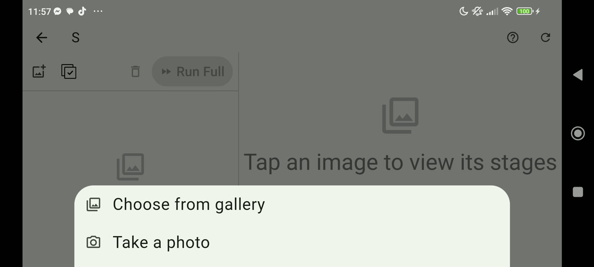

### Selecting and deleting

- Tick the checkbox of any image (or use **select-all** ✅ in the toolbar) to
  enable batch actions.
- With images ticked, the toolbar shows **Delete selected** 🗑 — the images
  move to the **Trash Bin** (nothing is lost permanently yet) — and
  **Run Full (n)** to process them all.
- The small 🗑 next to each file name moves just that image to the trash.

### What the status icons mean

Only *completed* progress gets an icon — an image that has not finished any
stage shows none. Tap the **?** button in the top bar for this legend at any
time:

| Icon | Meaning |
|------|---------|
| — *(no icon)* | Not started |
| ✅ green check | Stage 1 complete — plate aligned & warped |
| ✅ blue check | Stage 2 complete — wells detected |
| ✔✔ purple | All stages complete — results ready |

---

## 3. Running the analysis

Select an image in the list, then use the orange **Run Remaining Stages**
button at the top of the detail panel. The pipeline runs three stages in order:

1. **Stage 1 · Warp Grid** — finds the plate corners and flattens the photo.
2. **Stage 2 · Detect Wells** — finds every well on the warped plate.
3. **Stage 3 · Classify** — labels each well Growth / NoGrowth / NoAgar.

While a stage runs, a status overlay names the file and the current stage.
Runs are strictly one-at-a-time; you can leave the app mid-run and **Run
Remaining Stages** will resume from the first unfinished stage.

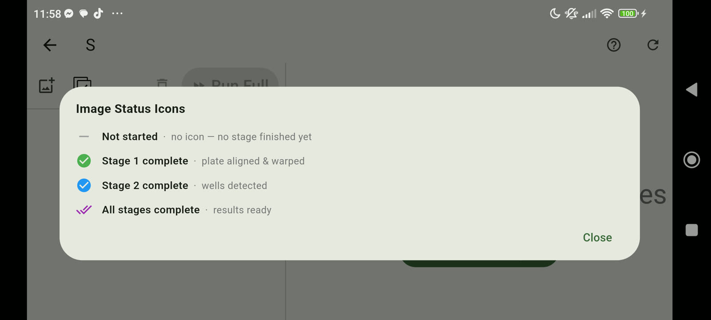

**Fine control** — each stage card has its own **Run** button (disabled until
the previous stage is done) and **Rerun** once complete. Rerunning a completed
pipeline asks for confirmation first.

**Batch** — tick several images and press **Run Full (n)**: every selected
image is processed, each resuming from its own progress.

---

## 4. Reading the results

As each stage completes, its card shows a preview of the output — the warped
plate, the detected wells, and the color-coded classification. Tap the
magnifier badge (🔍) on any preview to open it fullscreen with pinch-zoom.

Below the stage cards, the **Results Overview** panel summarizes the counts —
e.g. `Growth 372 · NoGrowth 12 · NoAgar 0 — 384 wells`.

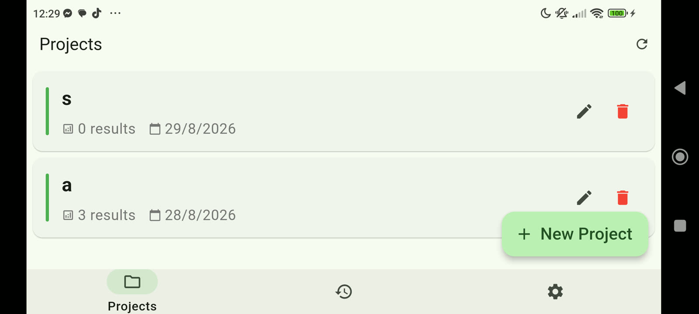

Tap **View Detail Result** for the full statistics page: a proportion bar,
per-class cards with percentages, a detection-confidence histogram, and
fullscreen overlays (**Result Detail** = color-coded classification,
**Confidence** = per-well confidence numbers).

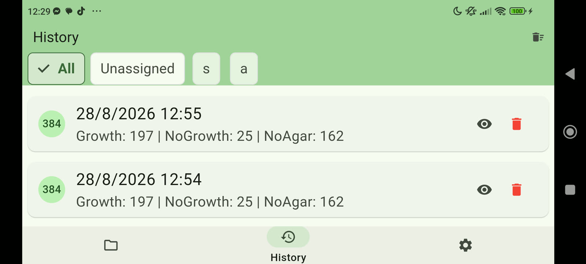

---

## 5. History

Every completed analysis is saved automatically to the **History** tab,
newest first. Filter chips at the top narrow the list to a single project.

- Tap the **eye** icon on a card to reopen the result: statistics, the
  annotated image, **Share**, and a project button.
- The project button shows **In project: *name***, or **Add to Project** if
  the result is unassigned. Tapping it lets you move the result to any
  project — or **Move to Trash Bin**.
- A result that sits in the trash stays listed in History, marked
  **In trash bin**, until it is permanently deleted from the Trash tab.

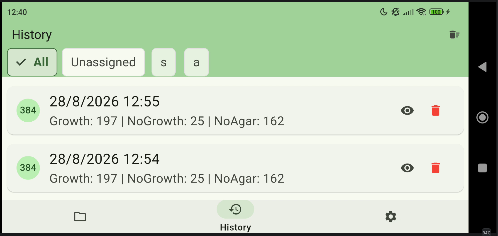

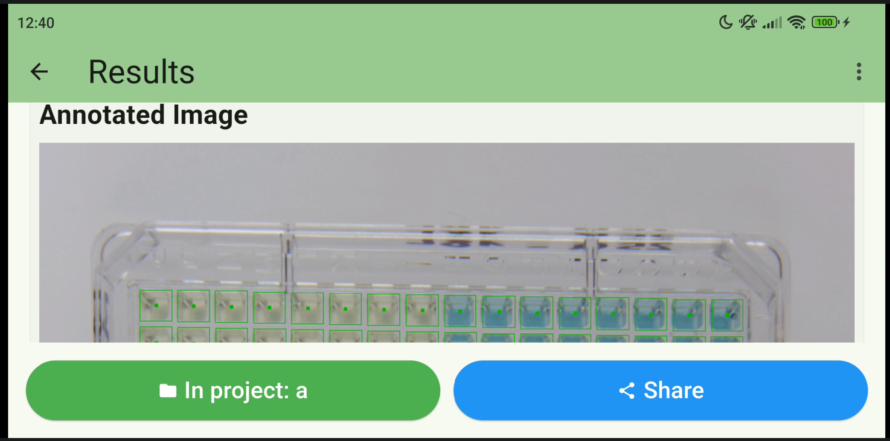

---

## 6. Trash Bin

Deleted images (and their results) land in the **Trash Bin** — nothing is
removed forever until you say so. Each card shows the pipeline status, which
project the image **was in**, and **when it was deleted**.

- Tap a card to inspect the trashed image's stages read-only.
- **Restore (⟲)** — pick *any* project to restore into; the card keeps the
  "was in" note for reference.
- **Delete forever (🗑)** — removes the image and its results permanently.
- The **Empty Trash** button (top bar) purges everything at once.

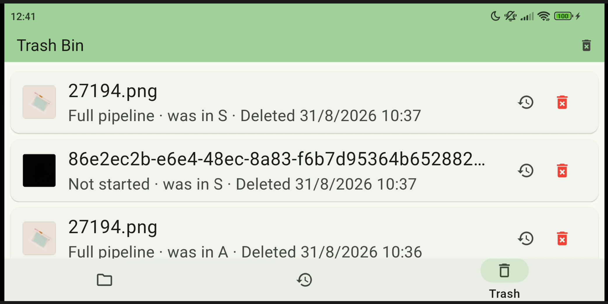

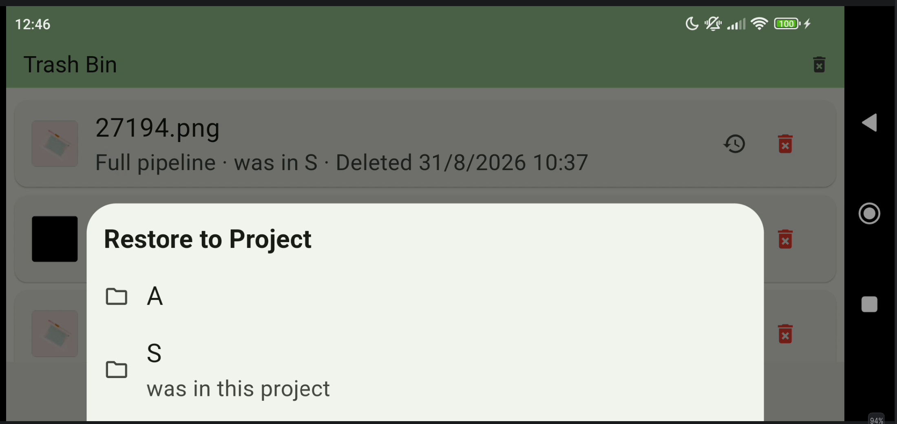

---

## 7. Tips & troubleshooting

- **Photo quality matters:** shoot the plate well-lit, roughly from above,
  with the whole plate in frame — Stage 1 needs to find all four corners.
- **First launch is slower** while models load (~2 s). Subsequent stage runs
  start immediately.
- **Interrupted a run?** Nothing is lost: reopening the project resumes each
  image from its first incomplete stage.
- **Storage:** originals and generated visualizations are kept on the device
  and can be large — empty the Trash Bin to reclaim space.
